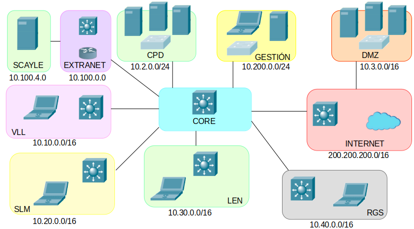

<div align="center">

# Red empresarial segura multisede

**Diseño y simulación en Cisco Packet Tracer de la red de una empresa con cuatro sedes: VLAN por departamento, EIGRP con rutas sumarizadas, 802.1X con RADIUS, WiFi gestionada por WLC, NAT y servicios públicos en DMZ.**


<sub>Diseño, Administración y Seguridad de Redes · Grado en Ingeniería Informática · Universidad de Valladolid · Curso 2023-2024</sub>

</div>

<p align="center">
  
  <br>
  <sub>Topología del proyecto final (extraída de la memoria).</sub>
</p>

## En pocas palabras

- **Reto**: diseñar la red de una empresa ficticia (soporte del agente conversacional *ChatCyL*) con oficinas en Valladolid, Salamanca, León y Burgos y un enlace dedicado con SCAYLE, partiendo de requisitos de negocio y técnicos.
- **Solución**: una red jerárquica completa simulada en Packet Tracer, con segmentación por departamento, red cableada y WiFi en todas las sedes, autenticación de usuarios y un portal web público aislado en una DMZ; documentada en tres entregas (Hito 1, Hito 2 e informe final). Proyecto en grupo (Grupo 04).
- **Demuestra**: diseño de redes a partir de requisitos, enrutamiento dinámico, seguridad de red por capas y configuración de equipos Cisco.

## Lo más destacado

- **Diseño jerárquico**: capas de núcleo y distribución, con sumarización de rutas EIGRP para reducir el tamaño de las tablas de enrutamiento.
- **Seguridad por capas**: VLAN por departamento, ACL entre subredes, Port Security, autenticación 802.1X con RADIUS en los switches y en la WLAN, y SNMPv3 con cifrado para la gestión.
- **Perímetro controlado**: el portal del empleado y la demo de ChatCyL viven en una DMZ separada de la red interna; NAT y rutas estáticas controlan la salida a Internet y hacia SCAYLE.
- **WiFi corporativa y de visitas**: controlador inalámbrico (WLC) con puntos de acceso ligeros (LAP) en todas las oficinas.
- **Alta disponibilidad practicada**: HSRP para redundancia de puerta de enlace y PVST/Rapid PVST, con pruebas de caída de enlace capturadas.
- **11 prácticas** de apoyo, cada una con su escenario de Packet Tracer y la entrega en PDF.

## Competencias

| Área | Qué se aplicó |
|------|---------------|
| Enrutamiento | EIGRP con sumarización, rutas estáticas, conmutación multicapa (MLS) |
| Conmutación | VLAN, VTP, PVST / Rapid PVST, HSRP |
| Seguridad de red | ACL, Port Security, 802.1X con RADIUS, DMZ, NAT, SNMPv3 |
| Servicios | DHCP, DNS, HTTP/HTTPS |
| Inalámbrico | WLC y puntos de acceso ligeros (LAP) |
| Ingeniería | Requisitos de negocio y técnicos → diseño → pruebas, documentado en informe técnico |

## Contenido

**Proyecto final (Grupo 04)**: red de la empresa con las cuatro sedes unidas por enlaces punto a punto y la conexión con SCAYLE para almacenamiento y cómputo. El fichero [`red_Grupo4.pkt`](Proyecto/Entrega_final/red_Grupo4.pkt) contiene la red completa y el [informe final](Proyecto/Entrega_final/informe_Grupo4.pdf) recoge el diseño y las pruebas.

**Prácticas de la asignatura:**

| Carpeta | Contenido |
|---------|-----------|
| [Practica_0](Practica_0/) | Guion y escenario inicial (`p0.pkt`) |
| [Practica_1](Practica_1/) | VTP y PVST: escenarios con STP activado, desactivado y en modo *rapid* |
| [Practica_2](Practica_2/) | Redundancia de puerta de enlace con HSRP, con capturas de ping normales y con fallos |
| [Practica_guiada_1](Practica_guiada_1/) | Listas de control de acceso (ACL) |
| [Practica_guiada_2](Practica_guiada_2/) | DNS y NAT |
| [Practica_guiada_3](Practica_guiada_3/) | Conmutación multicapa (MLS) |
| [Practica_guiada_4](Practica_guiada_4/) | Port Security y 802.1X |
| [Practica_guiada_5](Practica_guiada_5/) y [6](Practica_guiada_6/) | Enrutamiento |
| [Practica_guiada_7](Practica_guiada_7/) | Gestión de red |
| [Practica_guiada_8](Practica_guiada_8/) | Redes inalámbricas (WiFi) |

Cada práctica guiada contiene la actividad de Packet Tracer (`.pka`) y el PDF de capturas entregado.

## Estructura del repositorio

```text
DASR/
├── Practica_0/ … Practica_2/          # Prácticas evaluables (.pkt + guion/entrega en PDF)
├── Practica_guiada_1/ … _8/           # Prácticas guiadas (.pka + capturas en PDF)
├── docs/screenshots/                 # Imagen de la topología para este README
└── Proyecto/
    ├── Hito_1/memoria_Grupo4.pdf
    ├── Hito_2/memoria_grupo4.pdf
    └── Entrega_final/
        ├── informe_Grupo4.pdf         # Informe técnico final
        └── red_Grupo4.pkt             # Red completa en Packet Tracer
```

## Requisitos

- [Cisco Packet Tracer](https://www.netacad.com/courses/packet-tracer) (los ficheros `.pkt` y `.pka` solo se abren con esta herramienta)
- [Git](https://git-scm.com/) para clonar el repositorio

## Cómo abrirlo

```bash
git clone https://github.com/JavivuG/DASR.git
cd DASR
```

Abre [`Proyecto/Entrega_final/red_Grupo4.pkt`](Proyecto/Entrega_final/red_Grupo4.pkt) en Packet Tracer para ver la red completa. Las prácticas se abren del mismo modo desde su carpeta.

## Estado y limitaciones

- Es una red simulada en Packet Tracer, no un despliegue sobre equipos físicos.
- No se ha comprobado la compatibilidad con versiones concretas de Packet Tracer.

## Autoría

El proyecto final se hizo en grupo (Grupo 04); los integrantes figuran en el [informe final](Proyecto/Entrega_final/informe_Grupo4.pdf). Las prácticas son de Javier García González.

---

<div align="center"><sub>Parte de <a href="https://github.com/JavivuG/UVa-Projects">UVa-Projects</a> · Javier García González</sub></div>
